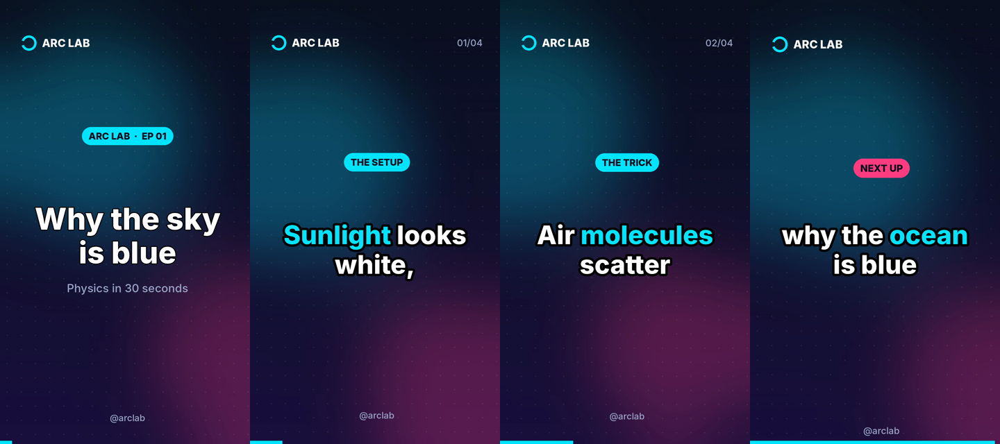

# Arc Lab Series — Claude video skill

A Claude skill that generates **Arc Lab** short-form vertical videos (9:16, 1080×1920)
for YouTube Shorts, Instagram Reels and TikTok. Ask Claude for an episode on a topic, and it
writes the script and storyboard, then renders the MP4 on your own machine with Pillow and ffmpeg.
You don't need API keys or a paid service.



Each video contains:
- a title card with the series name and episode number
- captions, a few words at a time, with the key word highlighted
- a small "kicker" label on each scene ("The setup", "The trick", …)
- a slow push-in on every scene and a progress bar along the bottom
- an outro that teases the next episode
- optional local text-to-speech narration (`espeak-ng` / `espeak` / macOS `say`) and a music bed
- an `.srt` caption file and a `_cover.png` thumbnail alongside the MP4

## Animated "Training Arc" episodes
`scripts/animate_arc.py` makes a fully code-drawn animated short. An original character
(Kai) fails a push-up, trains through a montage, powers up, levels up and teases Part 2.
Every frame is drawn with Pillow and all the music and sound effects are synthesized with numpy.
```bash
python3 ~/.claude/skills/arc-lab-series/scripts/animate_arc.py -o training-arc-part1.mp4
```

## Requirements
- Python 3.9+ with Pillow and numpy (`pip install Pillow numpy`)
- ffmpeg (`apt install ffmpeg`, `brew install ffmpeg`, or `winget install ffmpeg`)
- Optional: `espeak-ng` for narration (`apt install espeak-ng`)

## Download & install

**Claude Code: clone the repo and run the installer**
```bash
git clone https://github.com/shailesh501122/arclabskill.git
cd arclabskill
./install.sh              # installs to ~/.claude/skills/arc-lab-series
./install.sh --project    # or into ./.claude/skills of the current project
```

**One-liner** (after this branch is merged to `main`):
```bash
curl -fsSL https://raw.githubusercontent.com/shailesh501122/arclabskill/main/install.sh | bash
```

**claude.ai / Claude desktop app:** run `./package.sh` to build `dist/arc-lab-series.zip`,
then upload it under *Settings → Capabilities → Skills*. The skill runs ffmpeg, so it needs an
environment where code execution is enabled.

## Use it
In Claude Code:
> Make an Arc Lab episode about why cats purr

To render a storyboard yourself:
```bash
S=~/.claude/skills/arc-lab-series
python3 $S/scripts/render_short.py --check                       # verify dependencies
python3 $S/scripts/render_short.py $S/examples/episode-01.json --dry-run   # timing only
python3 $S/scripts/render_short.py $S/examples/episode-01.json -o ep01.mp4 --voice --music bed.mp3
```

The JSON storyboard format is documented in
[`skills/arc-lab-series/references/storyboard-format.md`](skills/arc-lab-series/references/storyboard-format.md).
You can change brand colors, the font and the social handle per series.

## Layout
```
skills/arc-lab-series/
  SKILL.md                     # instructions Claude follows
  scripts/render_short.py      # storyboard -> MP4 renderer
  references/storyboard-format.md
  examples/episode-01.json
install.sh                     # local or remote installer
package.sh                     # builds the .zip for claude.ai upload
```
